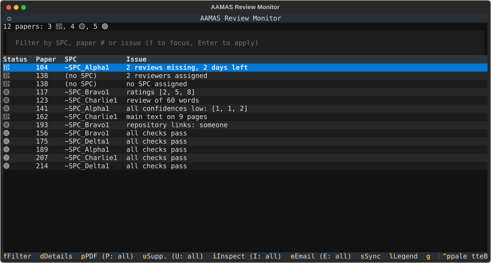
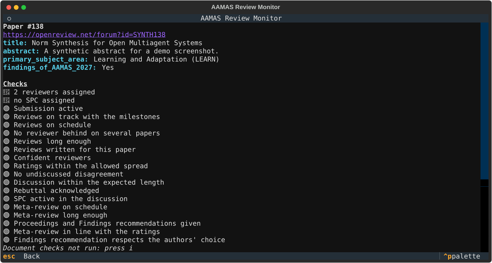
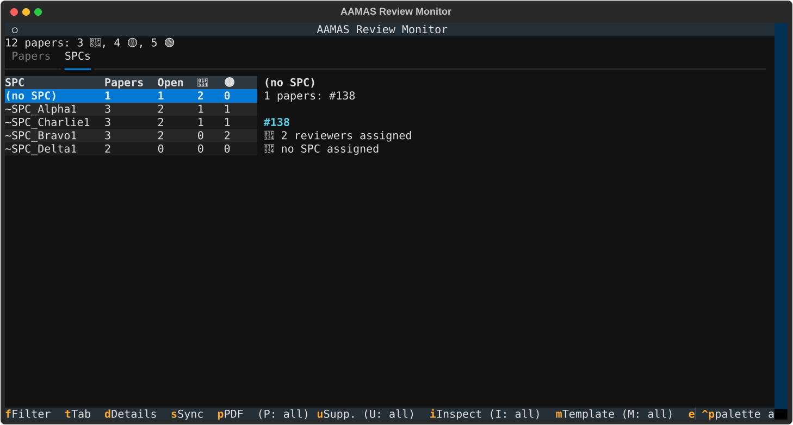
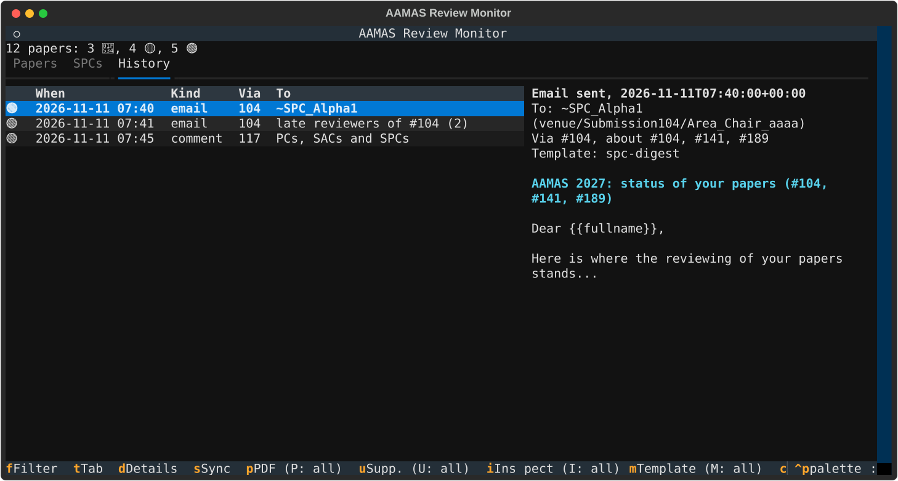

# AAMAS Review Monitor

**The review process of a hundred papers, on one screen.**

AAMAS Review Monitor is a command-line and terminal tool for Senior Area Chairs of
[AAMAS 2027](https://warwick.ac.uk/fac/sci/dcs/aamas2027/). It reads, from OpenReview, the papers
you supervise, then runs a few dozen checks on how their reviewing is going. Out comes a short,
prioritised list of what needs you today, grouped by the SPC (Area Chair) who can act on it.
Papers where everything is on track stay out of your way.



- **Every paper, every day, in seconds.** Assignments, missing and late reviews, short or
  recycled reviews, disagreements nobody is discussing, unacknowledged rebuttals, quiet SPCs,
  missing or inconsistent meta-reviews. The checks follow the AAMAS 2027 calendar.
- **Know whom to nudge.** Issues are grouped by SPC, and a reviewer late on several of your papers
  shows up once, so one reminder covers them all. Each sync also tells you what got resolved
  since the last one.
- **Submission policy at scale.** On request, it inspects PDFs and supplementary zips for the
  page limit (appendices included), the AAMAS 2027 template, anonymity leaks, missing code, and
  OpenReview metadata that doesn't match the PDF.
- **Everything at hand.** A paper's metadata, checks and reviews (reviewers kept anonymous), its
  PDF text and its supplementary file tree, without leaving the terminal.
- **Reminders that write themselves.** Each SPC can get one digest of every open issue on their
  papers. Ready-made templates cover late SPCs, late reviewers and approaching deadlines. Every
  message is previewed before anything is sent, and all of it goes through OpenReview's own
  messaging. A paper's issues can also be posted as a comment on its forum.
- **A record of every nudge.** Every email and comment the app sends is kept in a history, and
  shown on the paper and the SPC it concerns, so nobody gets the same reminder twice by accident.







## Automatic, deterministic, and on your machine

AAMAS 2027 forbids sharing submissions with AI systems and using AI to evaluate them. This
tool is built around that rule:

- **Every check is plain Python.** No language model, no randomness: the same data always gives
  the same flags, and each flag comes with the rule that raised it (`legend`).
- **Nothing is sent anywhere.** Data goes from OpenReview to `~/.aamas-review-monitor/` on your
  disk (mode 0700) and nowhere else. No telemetry.
- **It reads with your own OpenReview permissions** and never changes anything there. The one
  exception is email, and nothing is sent until you type `SEND`.
- **Flags are for people to verify.** The colors describe the health of the reviewing process,
  never the quality of a paper.
  - 🔴 needs you
  - 🟡 needs the SPC's attention
  - 🟢 nothing to do

## Checks

`legend` (or `l` in the terminal UI) prints this list with the thresholds currently in use.
Defaults follow the AAMAS 2027 timeline: 50% of reviews by 26 Oct, all by 13 Nov, rebuttal
20–24 Nov, discussion from 25 Nov, acknowledgement by 3 Dec, meta-reviews by 9 Dec.

### Paper checks: automatic, on every sync

| Check | Flags |
|---|---|
| Submission active | 🟡 withdrawn or desk-rejected papers (and skips all other checks for them) |
| SPC assigned | 🔴 no SPC |
| Enough reviewers assigned | 🔴 fewer than 3 reviewers |
| Reviews on track with the milestones | 🟡 fewer than 50% of the reviews in after 26 Oct |
| Reviews on schedule | 🟡 reviews missing in the last 5 days before the deadline; 🔴 in the last 2 days and once overdue |
| No reviewer behind on several papers | 🟡 a reviewer who owes reviews on 2 or more of your papers |
| Reviews long enough | 🟡 a review under 150 words |
| Reviews written for this paper | 🟡 a review that shares 60% or more of its phrases with the same reviewer's review of another paper |
| No leftover chatbot phrases in reviews | 🟡 a review containing a phrase like "as an AI language model" or "here is a review of" |
| No review dense with chatbot-favoured words | 🟡 a review with 3 or more words like "delve", "intricate", "showcase", and more than 3 per 1000 words |
| Confident reviewers | 🟡 every reviewer's confidence is 2 or lower |
| Ratings within the allowed spread | 🟡 ratings 3 or more points apart |
| No undiscussed disagreement | 🔴 ratings 3 or more apart and no reviewer has commented, from 25 Nov |
| Discussion within the expected length | 🟡 more comments than one per reviewer plus one per SPC |
| Rebuttal acknowledged | 🟡 reviewers who neither updated their review nor commented since the rebuttal, from 2 days before 3 Dec; 🔴 after |
| SPC active in the discussion | 🟡 an SPC silent on all of your papers for 7 days during the discussion |
| Meta-review on schedule | 🔴 no meta-review in the last 2 days before 9 Dec, and after |
| Meta-review long enough | 🟡 a meta-review under 80 words |
| Proceedings and Findings recommendations given | 🟡 either recommendation missing |
| Meta-review in line with the ratings | 🟡 "Strong Accept" for a paper in your bottom quarter by mean rating, "Reject" for one in your top quarter |
| Findings recommendation respects the authors' choice | 🟡 Findings acceptance recommended although the authors opted out |

### Document checks: on request (`inspect`, or `i`)

These use the PDF's text and properties and the supplementary zip's contents. The text is
converted one page at a time, for as many pages as `pdfinfo` counts, so page counts are the
PDF's own and findings about text say on which pages to look ("repository links: … (p. 2, 5)"). Missing files
are downloaded first. Results are cached per uploaded version; a new upload, or an update of
the checks themselves, makes them stale (shown as not run until you inspect again).

| Check | Flags |
|---|---|
| Main text within the page limit | 🔴 text before the references beyond 8 pages; 🟡 more than 8 pages and no References heading found |
| No appendix beyond the page limit | 🔴 an appendix after the references that takes main text plus appendix beyond 8 pages |
| Main text long enough | 🟡 main text under 6 pages |
| US Letter pages | 🔴 any other page size |
| Template fonts, all embedded | 🟡 fonts not embedded, or no Libertine (the template's typeface) |
| AAMAS 2027 template | 🟡 no AAMAS 2027 copyright block on page 1 |
| Anonymous submission mode | 🔴 no "Anonymous Author(s)" on page 1, or a name in the PDF's Author metadata |
| No identifying text | 🟡 emails on page 1, an Acknowledgements section, personal repository links, phrases like "our previous work" |
| OpenReview metadata matches the PDF | 🟡 the OpenReview title or abstract largely missing from the PDF's first pages |
| Supplementary material is one small zip | 🟡 not a zip, or over 25 MB |
| Anonymous supplementary material | 🔴 a `.git` folder; 🟡 home folder paths or emails in its files |
| Code available for the experiments | 🟡 experiments, but no code in the supplementary material and no code link |
| No leftover chatbot phrases | 🟡 a phrase like "as an AI language model", "Certainly! Here is" or "[insert" in the PDF |
| Not dense with chatbot-favoured words | 🟡 3 or more words like "delve", "intricate", "showcase", and more than 3 per 1000 words |

#### Signs of generated text

Four of the checks above look for signs of text written by a chatbot, in reviews and in PDFs.
They are plain string matching against two lists you can read and edit:
[`ai_phrases.txt`](aamas_review_monitor/resources/ai_phrases.txt) (phrases people rarely write,
like "as an AI language model") and [`ai_words.txt`](aamas_review_monitor/resources/ai_words.txt)
(words whose use jumped in scientific writing once chatbots spread, like "delve"). No model is
involved and nothing leaves your machine. They never give a probability, because no simple
method can estimate one reliably for a single text:

- **A leftover phrase** is concrete: you can find it in the text and judge it in seconds. Most
  generated text has none, so its absence proves nothing.
- **Many marker words** is a weak hint. Plenty of people, and many non-native writers, write
  like this, so it is only a reason to read the text. The thresholds (`ai_markers_min`,
  `ai_markers_per_1000_max`) are rough guesses: no real reviews or papers were used to tune
  them.

Only the list entries a review matches are kept in snapshots, never its text. AAMAS forbids
using AI to write reviews; what authors may do is up to the venue's policy, so treat a flag on
a paper as a question, not a finding.

Every threshold and date can be changed (see [Configuration](#configuration)). Adding a check
takes one documented function; see [`AGENTS.md`](AGENTS.md).

## Installation

You need Python 3.10 or newer. The document checks also need xpdf's or poppler's command-line
tools (`pdftotext`, `pdfinfo`, `pdffonts`): `brew install xpdf` on macOS, or
`apt install poppler-utils` on Debian and Ubuntu.

```bash
pip install "git+https://github.com/gciatto/aamas-review-monitor.git"
```

To install a fixed release, use its tag, or the wheel attached to the release on
[GitHub](https://github.com/gciatto/aamas-review-monitor/releases) (replace `X.Y.Z`):

```bash
pip install "git+https://github.com/gciatto/aamas-review-monitor.git@X.Y.Z"
pip install https://github.com/gciatto/aamas-review-monitor/releases/download/X.Y.Z/aamas_review_monitor-X.Y.Z-py3-none-any.whl
```

`pipx install …` or `uv tool install …` with the same URLs keeps it in an environment of its
own. The command is `aamas_review_monitor` (also `python -m aamas_review_monitor`).

## Getting started

```bash
aamas_review_monitor sync     # sign in, fetch your papers, take a snapshot
aamas_review_monitor tui      # browse the action queue
aamas_review_monitor report   # or print it
```

The first `sync` asks for your OpenReview credentials, or reads `OPENREVIEW_USERNAME` and
`OPENREVIEW_PASSWORD`. Only the resulting session token is kept, for one week
(`~/.aamas-review-monitor/token`; delete it to sign out). Run `sync` daily. Each run adds a
snapshot, and the report tells you what is new and what got resolved since the previous one.

## Command line

Paper lists (`N ...`) default to all your papers.

| Command | What it does |
|---|---|
| `sync` | Fetch your papers, their reviews and attachments' versions; save a snapshot; report updated PDFs and supplementary material |
| `report [--filter TEXT] [--green] [--csv FILE]` | The action queue by SPC, with changes since the last sync; filter by SPC, `#N`, issue or color; `--green` lists papers without issues too |
| `tui` | The interactive terminal UI |
| `legend` | What each check verifies, with the current thresholds |
| `show N` / `issues N` | A paper's metadata and issues / only its issues (passed checks included) |
| `reviews N [--reveal]` | Reviews and meta-reviews; reviewers stay anonymous unless `--reveal` |
| `browse N` | Open the paper on OpenReview |
| `download [N ...] [--supplementary]` | Download PDFs or supplementary material, skipping current copies |
| `attachment N [--supplementary] [--contents] [--open] [--reveal]` | A paper's PDF or zip, downloaded if needed: its path, its text or file list, open it, or show it in Finder/Explorer |
| `inspect [N ...]` | Run the document checks, downloading what is missing |
| `email ROLE [N ...] --subject S --body FILE` | Email `reviewers`, `late-reviewers` or `spcs`, one message per paper, after you type `SEND` |
| `templates` | List the email templates |
| `outreach TEMPLATE [N ...] [--spc ID ...]` | Compose templated emails from the current issues, preview every draft, send after you type `SEND` |
| `comment [N ...] [--spcs] [--text FILE]` | Post each paper's open issues (or the file's text) as a comment on its forum, readable by PCs and SACs (and SPCs with `--spcs`), after you type `SEND` |
| `history [N ...] [--full]` | Emails and comments sent from the app, newest first, optionally only about some papers |

Options that come before the command apply to every OpenReview request. `--rate` caps how
many requests the app makes per second (5 by default, `0` for no cap), so bulk syncs and
downloads stay under OpenReview's rate limits rather than only reacting once they hit them.
`--retries`, `--backoff` and `--backoff-max` set exponential backoff with jitter on rate
limits, server errors and connection failures, honouring `Retry-After`, for reads. The defaults
are 8 retries, a first wait of 1 s and a longest wait of 120 s. Email is never retried, so no
message goes out twice.

## Terminal UI

`tui` has three tabs (`t` switches between them):

- **Papers:** every paper, with one row per issue and a 🟢 row for each paper without issues.
  On terminals at least 120 columns wide, the selected paper's details sit beside the list.
- **SPCs:** each SPC with their papers, open issues and 🔴/🟡 counts, worst first, and the selected
  SPC's issues paper by paper, plus what was sent to them.
- **History:** every email and comment sent from the app, newest first, with the full text of
  the selected one.

The line above the tabs says where the process stands ("Reviewing: reviews due 13 Nov, in 25
days") and how old the snapshot is, in yellow once it is past `snapshot_stale_hours`.

Actions apply to the **marked** papers (or SPCs), and to the selected one when nothing is
marked. `space` marks or unmarks, `*` marks everything the filter shows (or clears the marks if
all are marked), and `a` opens a menu of what can be done, naming the papers it will act on.
The footer shows only these few keys. Each action also has its own key, listed in the menu and
in the command palette (`ctrl+p`):

| Key | Action |
|---|---|
| `f` | Filter by SPC, `#N`, issue text or color |
| `g` | Show or hide 🟢 papers |
| `space` / `*` | Mark or unmark the selected paper (or SPC) / everything shown |
| `a` | Action menu for the marked papers or SPCs, else the selected one |
| Enter, `d` | Paper details: metadata, every check with its outcome, anonymous reviews |
| `o` | Open the paper on OpenReview |
| `p` | PDF: for one paper, a dialog with its path and text (`c` shows it in Finder/Explorer, `v` opens it, `y` copies the path); for marked papers, download the missing ones |
| `u` | Supplementary material: the same, with the zip's file tree |
| `i` | Run the document checks, downloading what is missing |
| `m` | Templated email to the SPCs (SPCs tab) or to the papers' people, previewed in full before you type `SEND` |
| `c` | Comment on each paper's forum with its issues (editable for one paper; SPCs as readers optional), previewed before you type `SEND` |
| `e` | Free-form email to reviewers, late reviewers or SPCs, previewed before you type `SEND` |
| `t` | Switch between the Papers, SPCs and History tabs |
| `s` | Sync with OpenReview |
| `l` | Legend of all checks |
| `r` / `q` | Reload / quit |

Syncing, downloading, inspecting and sending run in the background behind a progress dialog,
and the rest of the interface waits meanwhile. The dialog keeps a live log of each step, of
every retry with the time it waits (and whether OpenReview asked for it), and of anything that
failed. Esc, or its Interrupt button, stops the job at the next paper, or right away during a
retry wait. Work already done stays: downloads and inspections are kept, while an interrupted
sync saves no snapshot. An expired session brings up a sign-in dialog. In the command line,
retries and waits are logged to the terminal, and `ctrl+c` interrupts.

## Email

`email` (or `e`) writes through each paper's OpenReview message invitation, signed as that
paper's Senior Area Chairs. Messages can go to its reviewers, to its late reviewers (assigned,
no review yet), or to its SPCs. `{{fullname}}` in the body becomes each recipient's name. Before
anything is sent, you see every message in full, with whom it goes to and through which paper,
the same preview as for templates (with the same warnings about repeats and old snapshots), and
you confirm by typing `SEND`. OpenReview doesn't let SACs email authors.

### Templates

`outreach` (or `m`) composes one message per recipient from the current issues. Shipped
templates:

| Template | To | About |
|---|---|---|
| `spc-digest` | each SPC | every open issue on the papers they supervise |
| `spc-late` | each SPC with pending SPC work | meta-reviews, recommendations, stalled discussions, unacknowledged rebuttals, silence |
| `spc-deadline` | each SPC still owing meta-reviews | the meta-review deadline |
| `reviewers-late` | each paper's late reviewers | their missing or behind-schedule review |
| `reviewers-deadline` | each paper's late reviewers | the review deadline |

SPCs get one message each, listing all their papers, sent through the message invitation of one
of those papers: OpenReview lets SACs write only through a paper's invitation, and any of an
SPC's papers reaches them. Reviewers get one message per paper. Templates are plain files in
[`aamas_review_monitor/resources/templates/`](aamas_review_monitor/resources/templates/):

- **Header:** `Name:`, `Description:`, `Audience:` (`spcs` or `late-reviewers`), `Codes:` (the
  issue codes it covers, or `*` for all) and `Subject:`.
- **Body:** after a `---` line. Placeholders are `$issues` (in SPC messages and comments, each
  paper's first issue from a check is followed by that check's legend entry, so the reader
  knows what it verifies), `$papers`, `$count`, and per paper
  `$paper`/`$url`, plus `$deadline_reviews`, `$deadline_meta_reviews`,
  `$deadline_acknowledgements` and the `$days_...` left for each. OpenReview fills in
  `{{fullname}}`.

Edit them, or add your own next to them.

### Comments and history

`comment` (or `c`) posts an Official_Comment on each paper's forum, signed as its Senior Area
Chairs. Program Chairs and SACs can always read it, and you choose whether its SPCs can too
(reviewers can't, at this stage). The text comes from
[`resources/comment.txt`](aamas_review_monitor/resources/comment.txt) with the paper's open issues,
and for a single paper you can edit it before posting.

Every email and comment the app sends, or fails to send, is appended to
`~/.aamas-review-monitor/history.jsonl`. It records when, through which paper, about which
papers, to whom, the subject and body, and the template used. `history` and the History tab show
it, and paper details and the SPCs tab show the part about each paper or SPC. Comments are
never retried automatically, so a comment can't be posted twice.

Every preview also checks the history. It flags each email whose recipients already got the
same template (or, for free-form emails, the same subject), and each paper that already has a
comment from the app. It also says how old the snapshot behind it is, with a warning once it is
older than `snapshot_stale_hours` (12 by default), because a reminder based on old data may
chase work that is already done. Warnings don't block sending: you still decide when you type
`SEND`.

## Configuration

Defaults are in
[`aamas_review_monitor/resources/config.json`](aamas_review_monitor/resources/config.json): the
venue, OpenReview field names, the AAMAS 2027 dates, every threshold, and the retry policy.
Override any of them in `~/.aamas-review-monitor/config.json`, for example
`{"reviews_words_min": 200, "deadline_meta_reviews": "2026-12-10"}`. Overrides are checked at
startup: a misspelt setting, a value of the wrong type or a malformed date stops the app with
the reason, instead of being quietly ignored. Use `AAMAS_MONITOR_DATA` to keep the data folder
elsewhere.

## Data and confidentiality

- Snapshots keep only process metadata: assignments, ratings, word counts, comment dates,
  MinHash fingerprints of reviews (comparable, but the text can't be recovered from them), and
  which entries of the marker lists a review matches.
- Paper content, reviews, PDFs, extracted text and document check results are cached in
  `~/.aamas-review-monitor/papers/`, and what the app sent in `history.jsonl` next to it.
- **Run it in your own terminal, not through an AI coding assistant.** Its output and its cache
  hold submissions, reviews and the identities of reviewers and SPCs.
- The project is developed and tested only on synthetic data. The screenshots above are
  synthetic too.

## Development

```bash
uv sync                    # environment and development tools
uv run poe test            # tests (synthetic data, no network)
uv run poe static-checks   # compile, ruff format/lint, mypy
uv run poe install-hooks   # optional local Git hooks
```

Commits follow [Conventional Commits](https://www.conventionalcommits.org/), from which
semantic-release derives versions. Releases are GitHub releases only: the wheel and sdist are
attached to each release and kept as workflow artifacts, and nothing is published to PyPI.
Contributor and agent notes, including how to add a check, are in [`AGENTS.md`](AGENTS.md).

## License

See [LICENSE](LICENSE).
